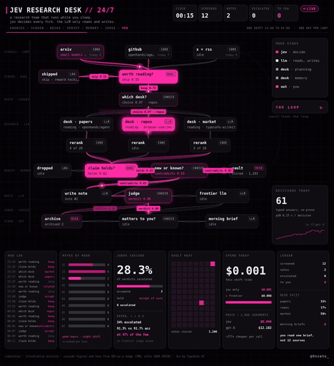

# JEV RESEARCH DESK // 24/7

a research team that runs while you sleep. jev decides every fork. the LLM only reads and writes.



a live ops dashboard that simulates an overnight AI research pipeline built on the **LLM writes, Jev decides, code acts** pattern.

one html file. no frameworks, no build step, no dependencies. open `index.html` in any browser and it runs.

## what you're looking at

sources (arxiv, github, x + rss) emit items all night. every fork in the pipeline is a typed decision, not a generated paragraph:

```
sources > worth reading? > which desk? > rerank > claim holds? > new or known?
        > write note > judge > matters to you? > morning brief
```

| node | type | what it decides |
|---|---|---|
| worth reading? | BOOL | keep or skip |
| which desk? | CHOICE | papers / repos / market |
| claim holds? | BOOL | keep or drop |
| new or known? | CHOICE | related / revises / contradicts / duplicate |
| judge | CHOICE | accept when sure, escalate to a frontier model when not |
| matters to you? | CHOICE | morning brief or archive |

the LLM nodes (desks, write note, frontier llm) only read and write. everything else is a cheap decision.

the clock compresses one night shift (22:00 to 07:00) into 20 seconds, then a new day starts.

## the numbers

the pipeline activity is simulated and illustrative.

the judge cascade figures and prices come from the CMU paper **JEV-as-a-Judge: Accept When Confident, Escalate When Unsure** ([arXiv 2609.26550](https://arxiv.org/abs/2609.26550)):

- confidence threshold 0.9: 34% of items escalated to the frontier judge
- 91.3% accuracy vs 91.7% for GPT-6 alone
- at 47% of the fee
- $0.044 vs $12.182 per 1,000 judgments

Jev is built by [TypeSafe AI](https://typesafe.ai). this project is not affiliated with TypeSafe or CMU.

## run it

```
git clone https://github.com/0xcato-dev/jev-research-desk
open jev-research-desk/index.html
```

or just download `index.html` and double click it.

there's a small pause button in the bottom right corner.

## capture it as video

the page exposes `window.renderAt(t)`, which steps the simulation deterministically to time `t` in seconds. open `index.html#capture` in a headless browser, call `renderAt(frame / 30)` for each frame, screenshot, and stitch with ffmpeg.

---

built by [@0xcato_](https://x.com/0xcato_). i break down how the best agent systems actually work.
